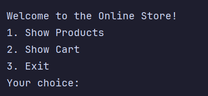
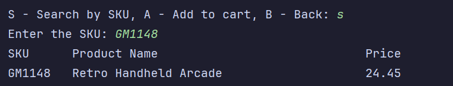
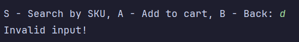

# Online Store

<!-- HOW TO USE THIS TEMPLATE
     Save it as README.md at the root of your project, next to pom.xml. Replace every comment like this one
     with your own text; comments do not show on GitHub, so what you leave untouched shows as an empty heading.
     Two sections are optional and say so: Class Diagram, and Data and configuration. When your project does not
     need one, delete the whole section, heading included. Every other section stays. -->

<!-- One sentence under the title: what the app is, for whom.
     Example: A console app that keeps a store's inventory in a csv file and lets a clerk search it. -->

## Description of the Project

<!-- Three to five sentences. What the application does, who uses it, what problem it solves.
     Write it for someone who has never seen the workbook: a recruiter, a classmate, you in six months. -->
This application mimics the interface of an online store through the terminal. Given a .csv of items, the terminal will display them to the user, process user input, calculate change, and archive receipts for the store owner. It defines a Product through four private variables: ID, Name, Price, and Department, allowing store owners to import .csv files and make meaningful objects with the items listed in the file.
## Features

<!-- One bullet per thing the app can do, in the order of your menu. Mark bonuses.
     For an API (Capstone 3), one line per endpoint instead: method, path, what it does.
     Be honest: list what works. If something is half done, say so under Future Work instead.
     Example:
     - Shows every product in the store
     - Searches products by name (bonus) -->

- Shows every product in the store
- Allows users to search products by ID (bonus)
- Shows all items in a user's cart
- Process payments and calculates change
- Prints out a receipt
- Adds quantity to each item in the receipt rather than repeating items (bonus)
- Archives receipts as a file in yyyyMMdd-HHmmss format (bonus)

## User Stories

<!-- The stories you worked from, one per bullet, in the format you learned in Workbook 3b:
     As a [type of user], I want [some goal] so that [some reason].
     Same text as the cards on your GitHub project board. -->

- As a store owner, I should be able to load the store's product inventory through a .csv, so that I can quickly import my product inventory.
- As a store owner, I should be able to create Products with given properties, so that my Products all have meaningful data.
- As a customer, I should be able to view products that the store sells and search by product ID, so that I can browse and buy what I want.
- As a customer, I should be able to add products I chose to my cart, so that I can see the total price and adjust my cart.
- As a customer, I should be able to check out and pay for my cart, so that I can get my products I want.
- As a store owner, I should be able to archive receipts of customer purchases, so that I can track sales.

## Setup

### Prerequisites

- Java 17 (Amazon Corretto), the version used in class.
- IntelliJ IDEA Community Edition: <https://www.jetbrains.com/idea/download/>

### Running the application

1. Clone this repository, or download it as a zip and unzip it.
2. In IntelliJ: File > Open, pick the project folder (the one that holds `pom.xml`), press Open.
3. Wait for IntelliJ to finish indexing (progress bar at the bottom).
4. Open `src/main/java/com/pluralsight/Store.java`. <!-- replace YourMainClassName with the class that has main -->
5. Right-click inside the file and choose Run 'Store.main()'.

### Data and configuration

<!-- OPTIONAL. Anything the program needs that is not code: data files and where they must sit, files the
     program creates, a database script to run first, a settings file to edit (connection, port).
     If there is nothing, delete this subsection, heading included.
     Example:
     - `inventory.csv` sits at the project root, next to `pom.xml`. The program reads it at start.
     - `logs.txt` is created by the program at the project root on the first run. -->

- `inventory.csv` sits at the project root, next to `pom.xml`. The program reads it at start.
- `receipts` directory is necessary for receipt .txt files.

## Technologies Used

- Java 17
- IntelliJ IDEA
<!-- Add anything else you used: a library, Maven plugins, an external tool. For a console app this list is short. That is fine. -->

## Demo

<!-- Pictures of the app running: the console for a console app, Insomnia or Swagger for an API.
     Screenshots are enough; a GIF is a bonus.
     1. Create a folder named `images` at the project root, next to `pom.xml`.
     2. Take screenshots of the app in the IntelliJ console (the menu, one feature, one error message):
          Windows: Win + Shift + S, drag a rectangle, then paste into Paint and save as PNG, or open the
                   notification and save. Save into the `images` folder.
          Mac:     Shift + Cmd + 4, drag a rectangle. The file lands on the Desktop; move it into `images`.
     3. Name the files by what they show: `images/menu.png`, `images/search.png`.
     4. Reference each one below with a relative path. No spaces in file names.
     5. Commit the images with the rest of your work (Git > Commit shows them as unversioned files: tick them).
     Optional GIF: LICEcap (free, Windows and Mac, <https://www.cockos.com/licecap/>) records a region of the
     screen straight to a .gif. Keep it under 10 seconds and under 10 MB, save it into `images`. -->







## A piece of code I am proud of

<!-- Paste one short block of your own code (5 to 15 lines) between the three backticks, then write two
     or three sentences: what it does and why you chose to write it that way. This is what you show on
     demo day and what you talk about in an interview. -->

```java
// accumulates total amount of each item
Map<Product, Integer> productIntegerMap = new HashMap<>();
for (Product product : cart) {
    productIntegerMap.put(product, productIntegerMap.getOrDefault(product, 0) + 1);
}
```

Accumulates the quantity of items through a hashmap. This allows us to display the quantity of items by looping through the array once.
## Future Work

<!-- What you would add or fix next, one bullet each. Unfinished bonuses belong here. -->

- Cleaner code structure
- More search options

## Resources

<!-- What helped you: the workbook, the week's hub pages, a tutorial, a documentation page. Real links. -->

- Java YearUp Fall 2026 hub: <https://raymaroun.github.io/yearup-java-fall2026/>

## Author

<!-- Your name and, if you like, your GitHub profile link. For a team workshop, one line per person with what each one built. -->

- **Tony Zhang**

## Thanks

<!-- Optional. The people who helped: the instructor, a classmate who debugged with you, a mentor. -->

- Thank you to Raymond for his instruction.